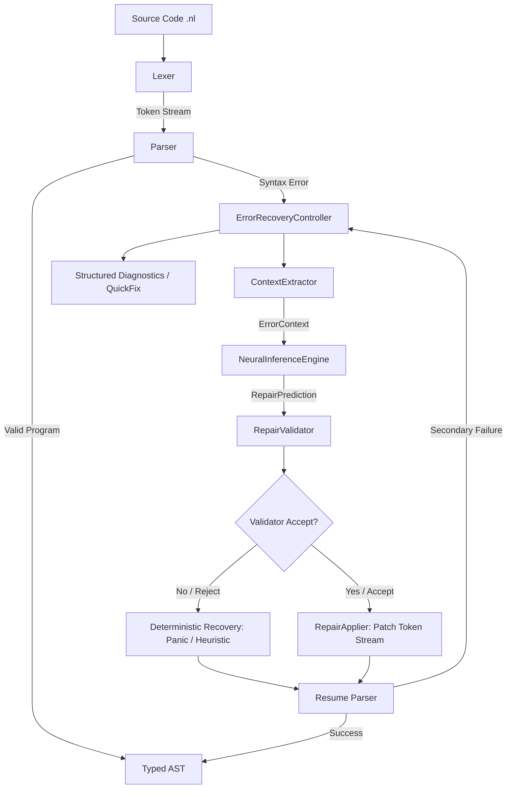

# NeuroParse Compiler Architecture (Phases 1–18 Final)

This document describes the end-to-end architecture, compiler pipeline, authority boundaries, and subsystem layouts in NeuroParse.

---

## 1. System Pipeline

---

## 2. Core Architectural Invariant: Authority Boundaries

The central design principle of NeuroParse is that **the machine learning model is an untrusted candidate proposer, while the deterministic compiler remains the sole authority.**

| Subsystem | Permitted Operations | Forbidden Operations |
|---|---|---|
| **ContextExtractor** | Reads token stream; extracts immutable `ErrorContext` window ($[-50, +10]$) and metadata. | Modifying token streams, AST nodes, or source files. |
| **NeuralInferenceEngine** | Evaluates local context; emits candidate `RepairPrediction` (operation, token, position, confidence). | Direct AST mutation, disk writes, executing code, cloud calls. |
| **RepairValidator** | Evaluates structural feasibility, token legality, bounds, and progress invariants. | Relying on confidence scores alone without deterministic verification. |
| **RepairApplier** | Executes atomic token insertions, deletions, and replacements on compiler token stream. | Out-of-bounds stream indexing, deleting EOF, unanchored tokens. |
| **ErrorRecoveryController** | Manages retry limits ($K=50$), consecutive loop detection, strategy dispatch, and fallback. | Unbounded retry loops, ignoring validator vetoes. |
| **Parser** | Authoritatively verifies syntactic legality and constructs typed AST hierarchy. | Trusting unvalidated repair suggestions. |

---

## 3. Subsystem Breakdown

1. **Lexer (`compiler/include/neuroparse/lexer/`):**
   - Scans NeuroLang source text into strongly typed tokens (`Token`).
   - Tracks 1-indexed source spans (`SourceLocation`).
   - Guarantees exactly one terminating EOF token.

2. **Parser (`compiler/include/neuroparse/parser/`):**
   - Combines recursive descent for declarations and statements with Pratt expression parsing.
   - Preserves parser state and cursor location for atomic resumption after token patching.

3. **AST (`compiler/include/neuroparse/ast/`):**
   - Typed node hierarchy (`Declaration`, `Statement`, `Expression`).
   - Single-ownership node semantics via `std::unique_ptr`.
   - Visitor pattern and ASCII tree formatter (`--dump-ast`).

4. **Error Recovery (`compiler/include/neuroparse/recovery/`):**
   - `PanicModeStrategy`: Statement-boundary and keyword synchronization.
   - `HeuristicRecoveryStrategy`: Single-delimiter insertion based on expectation sets.
   - `ContextExtractor`: Slices local token windows for neural embedding.
   - `NeuralInferenceEngine`: In-process predictor evaluating candidate syntax fixes.
   - `RepairValidator`: 6-stage non-mutating validation gate.
   - `RepairApplier`: Atomic token stream patcher.
   - `ErrorRecoveryController`: Strategy dispatcher with loop protection.

5. **Diagnostics & CLI (`compiler/include/neuroparse/cli/`):**
   - Emits human-readable standard diagnostics, recovery reports (`--explain-recovery`), step-by-step traces (`--trace-recovery`), and structured JSON diagnostics (`--diagnostics=json`).

6. **IDE Integration (`vscode-extension/`):**
   - VS Code extension integrating real compiler diagnostics and automated Quick Fix code actions.

---

## 4. Fallback Policy

If neural inference fails at any point (missing ONNX model, runtime error, low model confidence, out-of-bounds prediction, validator rejection, or failed parser resumption), the `ErrorRecoveryController` deterministically rolls back and triggers classical heuristic or panic-mode recovery. The compiler is guaranteed never to crash due to machine learning failures.
