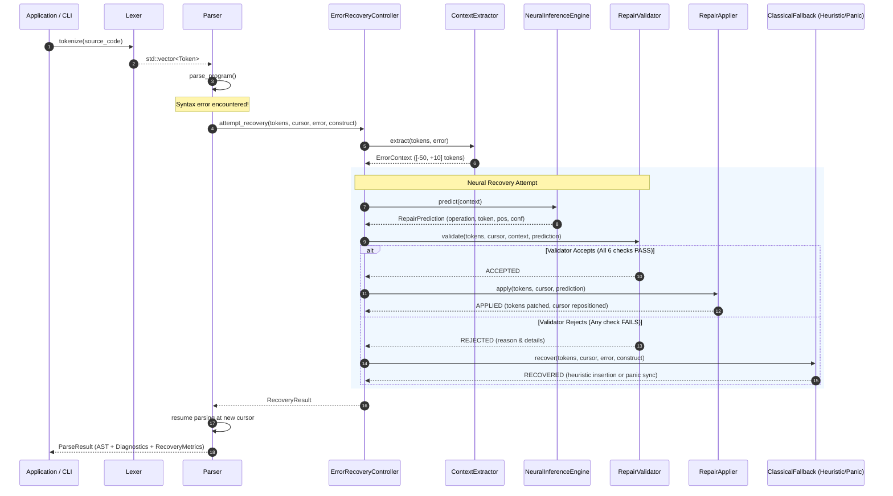

# Chapter 1: Architecture & Compiler Pipeline

This chapter details the high-level system architecture, component interactions, dataflow pipelines, and authority boundaries governing **NeuroParse**.

---

## 1. System Pipeline Overview

NeuroParse replaces the traditional catastrophic failure mode of recursive-descent parsers with an **in-process neural recovery loop**.



---

## 2. Core Architectural Invariant: The Tripartite Authority Model

A critical flaw of naive LLM integrations in compilers is hallucinations or corruption of compiler memory. NeuroParse solves this through a strict **Tripartite Authority Model**:

```
┌─────────────────────────────────┐
│     1. Untrusted Proposer       │  NeuralInferenceEngine
│  (Emits candidate predictions)  │  - Zero access to AST memory
│                                 │  - Zero disk/network access
└────────────────┬────────────────┘
                 │ RepairPrediction
                 ▼
┌─────────────────────────────────┐
│     2. Deterministic Gate       │  RepairValidator
│   (Validates against grammar)   │  - Non-mutating verification
│                                 │  - 6 invariant checks
└────────────────┬────────────────┘
                 │ Accepted Repair
                 ▼
┌─────────────────────────────────┐
│     3. Deterministic Executor   │  RepairApplier & Parser
│    (Safely patches & resumes)   │  - Atomic token stream edit
│                                 │  - Monotonic progress guarantee
└─────────────────────────────────┘
```

### Authority Matrix

| Subsystem | Source Location | Permitted Operations | Prohibited Operations |
|---|---|---|---|
| **Lexer** | [lexer.cpp](file:///c:/Users/shiva/OneDrive/Desktop/neurology/compiler/src/lexer/lexer.cpp) | Read source text; emit tokens with locations; emit exactly one `EOF`. | Token modification, error recovery. |
| **Parser** | [parser.cpp](file:///c:/Users/shiva/OneDrive/Desktop/neurology/compiler/src/parser/parser.cpp) | Construct typed AST; maintain cursor; invoke recovery controller on failure. | Trusting unvalidated repair suggestions. |
| **ContextExtractor** | [context_extractor.cpp](file:///c:/Users/shiva/OneDrive/Desktop/neurology/compiler/src/recovery/context_extractor.cpp) | Read token stream slice ($[-50, +10]$); extract `ErrorContext`. | Modifying token stream or parser state. |
| **NeuralInferenceEngine** | [neural_recovery.cpp](file:///c:/Users/shiva/OneDrive/Desktop/neurology/compiler/src/recovery/neural_recovery.cpp) | Predict `RepairPrediction` (operation, token, position, confidence). | Direct AST or token mutation; disk/network calls. |
| **RepairValidator** | [repair_validator.cpp](file:///c:/Users/shiva/OneDrive/Desktop/neurology/compiler/src/recovery/repair_validator.cpp) | Deterministically verify operation, token legality, bounds, safety, and progress. | Mutating token stream; accepting based on probability alone. |
| **RepairApplier** | [repair_applier.cpp](file:///c:/Users/shiva/OneDrive/Desktop/neurology/compiler/src/recovery/repair_applier.cpp) | Atomically execute `INSERT_TOKEN`, `DELETE_TOKEN`, `REPLACE_TOKEN` on token vector; update cursor. | Out-of-bounds stream indexing; deleting `EOF`; unanchored inserts. |
| **ErrorRecoveryController** | [error_recovery_controller.cpp](file:///c:/Users/shiva/OneDrive/Desktop/neurology/compiler/src/recovery/error_recovery_controller.cpp) | Coordinate strategy fallback chain; track retry count ($K \le 50$); detect repetition loops. | Unbounded retry loops; ignoring validator vetoes. |

---

## 3. Subsystem Breakdown

### 1. Lexical Analysis (`neuroparse::lexer`)
- Header: [`compiler/include/neuroparse/lexer/lexer.hpp`](file:///c:/Users/shiva/OneDrive/Desktop/neurology/compiler/include/neuroparse/lexer/lexer.hpp)
- Scans NeuroLang source text into a sequential vector of `Token`.
- Maintains 1-indexed line and column coordinates (`SourceLocation`).
- Guarantees:
  1. The token stream is never empty.
  2. The stream ends with exactly one `TokenType::Eof` token.
  3. Every token has monotonically non-decreasing start offsets.

### 2. Syntactic Analysis (`neuroparse::parser`)
- Header: [`compiler/include/neuroparse/parser/parser.hpp`](file:///c:/Users/shiva/OneDrive/Desktop/neurology/compiler/include/neuroparse/parser/parser.hpp)
- Employs recursive descent for statements and declarations.
- Employs a Pratt parser for expressions with 10 explicit precedence levels.
- Emits a typed `ast::Program` node or captures `ParserError` structures.

### 3. Abstract Syntax Tree (`neuroparse::ast`)
- Header: [`compiler/include/neuroparse/ast/ast.hpp`](file:///c:/Users/shiva/OneDrive/Desktop/neurology/compiler/include/neuroparse/ast/ast.hpp)
- Strict single-ownership node hierarchy using `std::unique_ptr<ASTNode>`.
- Visitor pattern support via `ASTVisitor` and `ConstASTVisitor`.
- Structural ASCII tree serialization via `ASTPrinter` (`--dump-ast`).

### 4. Recovery Subsystem (`neuroparse::recovery`)
- Header: [`compiler/include/neuroparse/recovery/error_recovery_controller.hpp`](file:///c:/Users/shiva/OneDrive/Desktop/neurology/compiler/include/neuroparse/recovery/error_recovery_controller.hpp)
- Orchestrates multi-tier recovery strategies:
  - `RecoveryMode::Auto`: Try Neural $\to$ Heuristic $\to$ Panic.
  - `RecoveryMode::Neural`: Direct neural repair with validation.
  - `RecoveryMode::Heuristic`: Common deterministic delimiter insertion.
  - `RecoveryMode::Panic`: Statement-boundary synchronization.
  - `RecoveryMode::None`: Fail-fast without recovery.

### 5. Diagnostics & CLI (`neuroparse::cli`)
- Header: [`compiler/include/neuroparse/cli/cli.hpp`](file:///c:/Users/shiva/OneDrive/Desktop/neurology/compiler/include/neuroparse/cli/cli.hpp)
- Formats standard GCC/Clang-style terminal diagnostics.
- Emits aggregate recovery summaries (`--explain-recovery`).
- Emits chronological step-by-step traces (`--trace-recovery`).
- Generates structured JSON output (`--diagnostics=json`) consumed by IDE extensions.

---

## 4. Parser Resumption & State Restoration

When a repair is accepted and applied:
1. **Token Stream Mutation:** `RepairApplier` modifies `std::vector<Token>& tokens` in place.
2. **Cursor Repositioning:**
   - On `InsertToken`: Cursor is repositioned to parse the newly inserted token.
   - On `DeleteToken`: Cursor stays at the current position, which now points to the subsequent token.
   - On `ReplaceToken`: Cursor is positioned at the replaced token.
3. **Parse Resumption:** The parser re-evaluates `current()` and resumes execution of the enclosing grammar rule without stack unrolling.

---

## 5. Fail-Safe Fallback Policy

If any condition in the neural path fails:
- ONNX model file missing or unreadable
- ONNX Runtime initialization failure
- Prediction confidence below threshold
- `RepairValidator` returns `ValidationStatus != Accepted`
- Parser fails to make forward progress after applying repair

The `ErrorRecoveryController` immediately triggers the classical fallback strategy:
1. **Heuristic Recovery:** Attempts single-token deterministic insertions based on parser expectations (e.g., missing `;`, `)`, `}`).
2. **Panic Mode Synchronization:** If heuristics fail, skips tokens until reaching a statement boundary delimiter (`;`) or statement starter keyword (`let`, `if`, `while`, `return`, `function`).

**Guaranteed Invariant:** The compiler *never* aborts, hangs, or crashes due to neural model failure.
